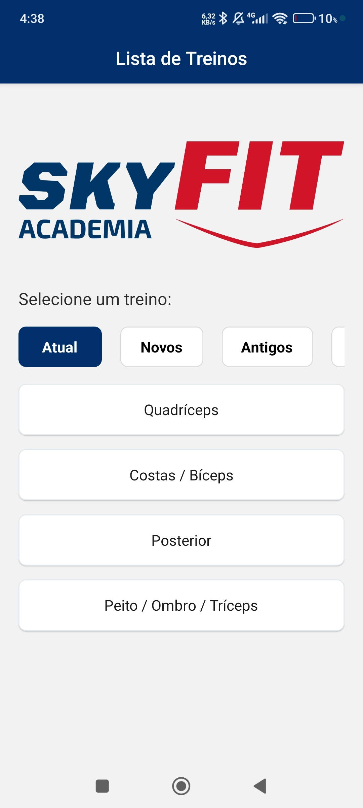
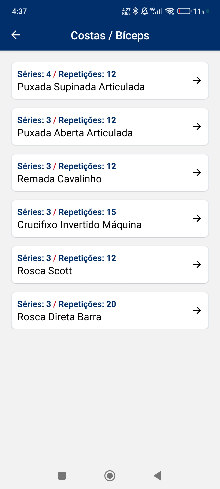

# Screenshots

<div align="center">
  
  
</div>

# CPAD checkpoint - FIAP

<details>
  <summary><b>useState / useEffect</b></summary>

```jsx
// (...)

// line 8 - screens/homePage.jsx
const [appData, setappData] = useState(null);
  
    useEffect(() => {
      async function getExercises() {
        const response = await fetch("https://gist.githubusercontent.com/Euro-beat/9356acf9edc8507f9adeeba2981d8621/raw/skiefite.json");
        const json = await response.json();
        setappData(json);
      }
      getExercises();
      }, []
    );

    const [activeCategory, setActiveCategory] = useState('cat1');

// (...)
```
</details>

<details>
  <summary><b>FlatList</b></summary>

```jsx
// (...)

// line 44 - screens/homePage.jsx -> only shows appData['exercisesDatabase']['costasBiceps'], for now (WIP)
<View style={{height: 80}}>

<FlatList
    data={appData["homePageCategories"]}
    horizontal
    showsHorizontalScrollIndicator={false}
    contentContainerStyle={styles.horizontalButtonsContainer}
    keyExtractor={(item) => item.id}
    renderItem={({ item }) => {
    const isActive = item.id === activeCategory;
    return (
        <TouchableOpacity 
        style={[styles.horizontalButton, isActive && styles.activeButton]}
        onPress={() => setActiveCategory(item.id)}
        >
        <Text style={[styles.horizontalButtonText, isActive && styles.horizontalButtonActive]}>
            {item.name}
        </Text>
        </TouchableOpacity>
    );
    }}
/>

</View>

<FlatList
    data={exerciciosFiltrados}
    keyExtractor={(item) => item.id}
    contentContainerStyle={styles.verticalButtonsContainer}
    style={{flex: 1}}
    renderItem={({ item }) => (
    <TouchableOpacity
        activeOpacity={0.7}
        style={styles.verticalButton}
        onPress={() => 
        navigation.navigate(
            'ExerciseMain',
            {
            trainingSplitShow: appData['exercisesDatabase']['costasBiceps'],
            screenTitle: item.name
            }
        )
        }
    >
        <Text style={styles.verticalButtonsText}>{item.name}</Text>
    </TouchableOpacity>
    )}
/>

</View>
// (...)
```
</details>

<details>
  <summary><b>JSON preview</b></summary>

```json
{
    "homePageCategories": [
        { "id": "cat1", "name": "Atual" },
        { "id": "cat2", "name": "Novos" },
        { "id": "cat3", "name": "Antigos" },
        { "id": "cat4", "name": "Teste" }
    ],
    "homePageExercises": [
        {"id": "1", "name": "Quadríceps", "catId": "cat1", "value": "quadriceps"},
        {"id": "2", "name": "Costas / Bíceps", "catId": "cat1", "value": "costasBiceps"},
        {"id": "3", "name": "Posterior", "catId": "cat1", "value": "posterior"},
        {"id": "4", "name": "Peito / Ombro / Tríceps", "catId": "cat1", "value": "peitoOmbroTriceps"},
        
        {"id": "5", "name": "Quadríceps", "catId": "cat2", "value": "quadricepsOld"},
        
        {"id": "6", "name": "A", "catId": "cat3", "value": "listA"}
    ],
    "exercisesDatabase": {
        "quadriceps": {
            "title": "Quadríceps",
            "exercises": [
                { "id": "1", "name": "Cadeira Adutora", "sets": 4, "reps": 12 },
                { "id": "2", "name": "Agachamento Smith", "sets": 3, "reps": 12 },
                { "id": "3", "name": "Afundo", "sets": 3, "reps": 12 },
                { "id": "4", "name": "Leg Press 180°", "sets": 3, "reps": 15 },
                { "id": "5", "name": "Búlgaro Máquina", "sets": 3, "reps": 12 },
                { "id": "6", "name": "Cadeira Extensora Unilateral", "sets": 3, "reps": 20 },
                { "id": "7", "name": "Panturrilha Máquina Sentado", "sets": 3, "reps": 20 }
            ]
        },
        "costasBiceps": {
            "title": "Costas, bíceps",
            "exercises": [
                { "id": "8", "name": "Puxada Supinada Articulada", "sets": 4, "reps": 12 },
                { "id": "9", "name": "Puxada Aberta Articulada", "sets": 3, "reps": 12 },
                { "id": "10", "name": "Remada Cavalinho", "sets": 3, "reps": 12 },
                { "id": "11", "name": "Crucifixo Invertido Máquina", "sets": 3, "reps": 15 },
                { "id": "12", "name": "Rosca Scott", "sets": 3, "reps": 12 },
                { "id": "13", "name": "Rosca Direta Barra", "sets": 3, "reps": 20 }
            ]
        }
    }
}
```

</details>

# How to run:
TODO

# Download (.apk)
TODO

# Stack
 - React Native
 - [GitHub Gist](https://gist.github.com/Euro-beat/9356acf9edc8507f9adeeba2981d8621)

# Next features
 - [ ] Multi-users
 - [ ] Offline persistence
 - [ ] Workouts descriptions with user input (file persistence?)